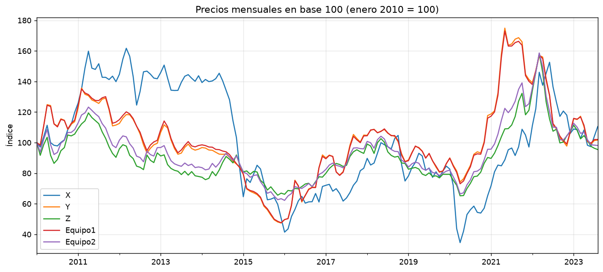
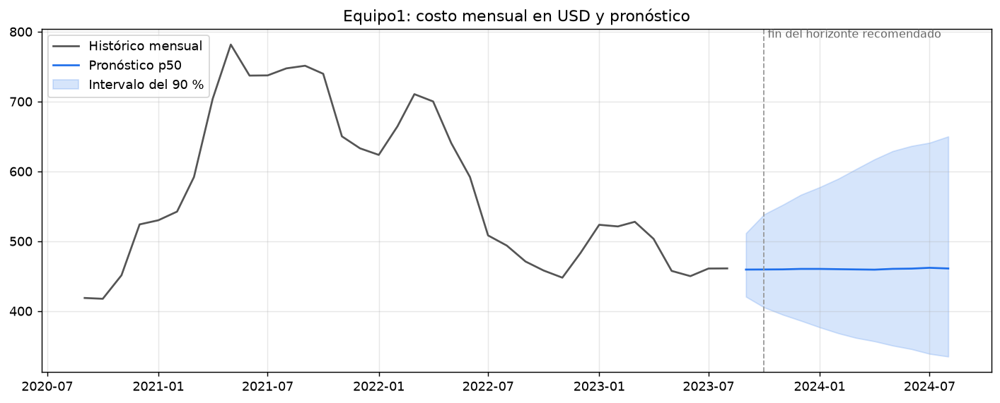
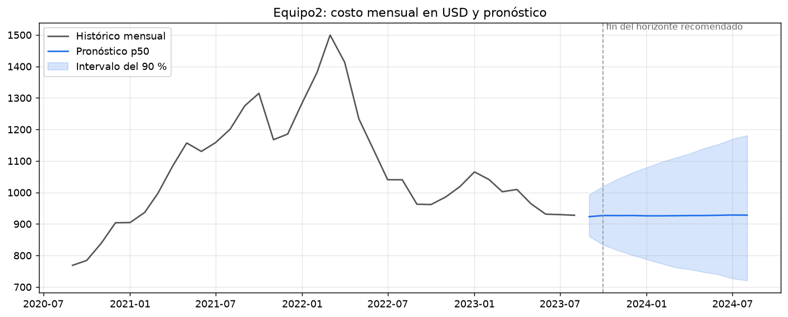
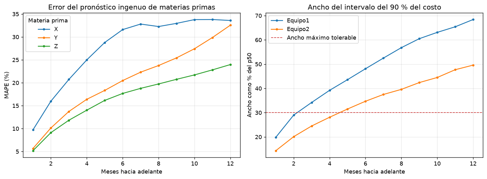
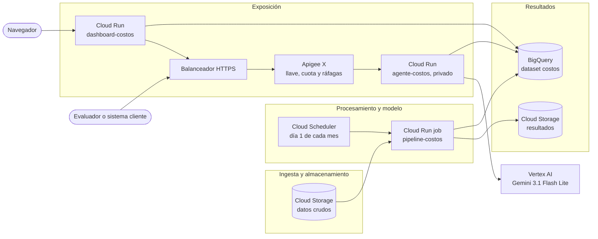

# Informe: pronóstico del costo de equipos a partir de materias primas

**Prueba técnica 1 · Gestión de costos operativos en un proyecto de construcción · Octubre de 2026**

El costo de los dos equipos se explica casi por completo con los precios de las materias primas del mismo mes. El **Equipo 1** depende de **Y** (96 % del costo) y de **X**; la materia prima **Z** es ruido para este equipo. El **Equipo 2** depende de las tres, con **Z** como componente principal (77 % del costo). Con esa relación se proyecta el costo a 12 meses con intervalos, y se recomienda presupuestar con un horizonte de **2 meses** y volver a pronosticar cada mes.

| Equipo | Relación estimada (USD) | Error fuera de muestra | Pronóstico de septiembre de 2023 (mediana) | Intervalo del 90 % |
| --- | --- | --- | --- | --- |
| Equipo 1 | −0.05 + 0.198·X + 0.800·Y | 0.34 % | 459.39 | 420.49 a 511.50 |
| Equipo 2 | 0.64 + 0.335·X + 0.335·Y + 0.332·Z | 0.18 % | 923.24 | 860.97 a 992.94 |

**Dónde está cada entregable**

| Entregable | Ubicación |
| --- | --- |
| Código funcional | `src/costos/`, con pruebas en `tests/` y notebooks en `notebooks/` |
| Proyección de costos | Sección 5 de este informe y `Resultados/pronostico.csv` |
| Agente de IA y explicación de IA convencional frente a agente | Anexo A; código en `src/costos/agente/` |
| Arquitectura en la nube | Anexo B; imágenes en `docker/` y `cloudbuild.yaml` |
| Informe | Este documento, secciones 1 a 7 |

Todas las cifras de este informe salen de los archivos de `Resultados/`, que el pipeline regenera con `make pipeline`.

---

## 1. Explicación del caso

Una constructora planea un proyecto en el que comprará de forma continua dos tipos de equipos. El precio de compra de esos equipos ha variado sin que la empresa pueda anticiparlo, y eso ha provocado desviaciones de presupuesto. La gerencia sospecha que el precio sigue al de ciertas materias primas, pero no sabe cuáles importan para cada equipo ni tiene un modelo que lo respalde.

El encargo tiene cuatro partes:

1. **Identificar** qué materias primas explican el precio de cada equipo y cuáles son ruido.
2. **Estimar** el costo de forma sistemática y repetible, no con un análisis de una sola vez.
3. **Proyectar** el costo hacia adelante con su incertidumbre y con un horizonte justificado.
4. **Exponer** los resultados en un agente de IA y proponer la arquitectura en la nube que sostiene la solución.

**Datos recibidos**

| Archivo | Contenido | Filas | Periodo |
| --- | --- | --- | --- |
| `X.csv` | Precio diario de la materia prima X | 9,144 | 1988-06-27 a 2024-04-04 |
| `Y.csv` | Precio diario de la materia prima Y | 4,485 | 2006-07-11 a 2023-09-12 |
| `Z.csv` | Precio diario de la materia prima Z | 3,565 | 2010-01-01 a 2023-08-31 |
| `historico_equipos.csv` | X, Y, Z y el precio de los dos equipos, en días hábiles | 3,530 | 2010-01-04 a 2023-08-31 |

---

## 2. Supuestos

1. **Moneda y unidad.** Los archivos no indican moneda ni unidad. Los precios se tratan como USD por unidad de equipo.
2. **Ventana de análisis.** Solo hay precio de equipos entre enero de 2010 y agosto de 2023, así que el modelo usa ese periodo. La historia anterior de X e Y no se usa porque no tiene con qué compararse.
3. **Frecuencia mensual.** El proyecto se planea por mes y el ruido diario oculta la relación. Cada serie se promedia por mes calendario: 164 meses.
4. **Relación lineal y del mismo mes.** El precio del equipo responde al precio de las materias primas del mismo mes. Las correlaciones con rezagos de 1 a 3 meses son bajas (sección 4.2).
5. **Relación estable.** Los coeficientes se suponen constantes. Se comprueba midiendo el error en los últimos 24 meses, que el modelo no vio al entrenarse, y el pipeline los vuelve a estimar en cada corrida.
6. **El futuro se parece al pasado.** Los cambios mensuales futuros de las materias primas se toman de los cambios observados entre 2010 y 2023. No se incorpora una opinión sobre tendencias ni cambios de régimen.
7. **Inicio del proyecto.** El enunciado no da las fechas del proyecto. Se supone que arranca después del último dato, en septiembre de 2023, y se proyectan 12 meses.
8. **Tolerancia a la incertidumbre.** Un pronóstico sirve para presupuestar mientras su intervalo del 90 % mida como máximo el 30 % del valor central, cerca de ±15 %. Es una decisión de negocio que debe validar la gerencia; es un parámetro del pipeline (`--ancho-maximo`).
9. **Alcance del costo.** Las series son precios de adquisición. No hay volúmenes, fletes, tipo de cambio ni datos por proveedor, así que no se modelan.

---

## 3. Formas para resolver el caso y la opción tomada en esta prueba

**Qué materias primas explican cada equipo**

| Alternativa | Por qué se tomó o se descartó |
| --- | --- |
| Elegir por correlación simple | Descartada. Dos series con tendencia correlacionan aunque no estén relacionadas: Z tiene correlación de 0.86 con el Equipo 1 y no mejora su modelo, mientras que X tiene 0.53 y sí es necesaria. |
| Regresión con todas las variables y selección por p-valor | Descartada. Elegir con los mismos datos con que se ajusta premia el sobreajuste. |
| Lasso, árboles o *gradient boosting* | Descartados. Con 3 variables candidatas y 164 meses no hace falta su flexibilidad, son menos interpretables y los árboles no extrapolan fuera del rango de precios visto. |
| **Regresión lineal por equipo, elegida fuera de muestra** | **Opción tomada.** Se ajustan las 7 combinaciones posibles de X, Y y Z, se entrena hasta agosto de 2021 y se mide el error en los 24 meses siguientes. Gana la combinación con menos variables cuyo error quede a menos de 10 % del mejor. |

**Cómo proyectar el costo**

| Alternativa | Por qué se tomó o se descartó |
| --- | --- |
| Pronosticar el precio del equipo directamente con su propia serie | Descartada. Ignora la relación con las materias primas, que es lo que la gerencia quiere usar. |
| Pronosticar cada materia prima con ARIMA o suavizamiento exponencial y pasar un solo valor por la regresión | Descartada como método único. En las pruebas con datos pasados (*backtesting*) ninguno supera con claridad a repetir el último valor (sección 5.1), y un solo número esconde el riesgo. |
| **Simulación de Montecarlo sobre las materias primas** | **Opción tomada.** Se generan 5,000 escenarios a 12 meses remuestreando meses históricos completos, lo que conserva el movimiento conjunto de X, Y y Z. Cada escenario pasa por la regresión del equipo y de ahí salen la mediana y el intervalo. |

**Hasta dónde confiar en la proyección**

Se descartó fijar el horizonte por calendario, por ejemplo 12 meses, porque no dice nada sobre la calidad del pronóstico. Se eligió el número de meses consecutivos en que el intervalo del 90 % sigue dentro de la tolerancia del supuesto 8.

**Cómo entregar los resultados**

Un reporte estático no responde preguntas nuevas. Se construyó un agente de IA que consulta los resultados con herramientas (anexo A), un tablero web para verlos, y un pipeline mensual en Google Cloud que los mantiene al día (anexo B).

---

## 4. Resultados del análisis de los datos y los modelos

### 4.1 Calidad de los datos

Cada archivo llega con un formato distinto, y el código lo documenta y lo valida:

- `X.csv`: separador coma, fechas ISO y orden descendente.
- `Y.csv`: separador punto y coma, decimales con coma, fechas día/mes/año y marca BOM al inicio.
- `Z.csv`: columnas invertidas, el precio va antes que la fecha.

Antes de modelar, el pipeline revisa fechas duplicadas, valores faltantes, precios no positivos y que el histórico coincida con los archivos individuales en las fechas comunes. Los datos entregados pasan las cuatro revisiones. Si alguna falla, el pipeline se detiene y no publica nada.

### 4.2 Exploración

En la gráfica, el Equipo 1 sigue casi exactamente a Y, y el Equipo 2 se mueve con Z. La tabla de correlaciones mensuales lo confirma. Se calcula en niveles y en variaciones porque una relación real aparece en ambas, mientras que una coincidencia de tendencias solo aparece en niveles.

| Correlación mensual | X | Y | Z |
| --- | --- | --- | --- |
| Equipo 1, niveles | 0.529 | 0.999 | 0.855 |
| Equipo 1, variaciones | 0.334 | 0.996 | 0.443 |
| Equipo 2, niveles | 0.535 | 0.922 | 0.987 |
| Equipo 2, variaciones | 0.505 | 0.652 | 0.957 |

Otros dos hallazgos de la exploración:

- **La frecuencia diaria es ruido.** Con datos diarios, la correlación de las variaciones del Equipo 1 con Y baja de 0.996 a 0.377, y la del Equipo 2 con Z de 0.957 a 0.396. Por eso se trabaja por mes.
- **No hay rezagos útiles.** La correlación del Equipo 1 con Y es 0.996 en el mismo mes, 0.426 con un mes de rezago y −0.049 con dos. La del rezago 1 la produce en parte el propio promedio mensual.

### 4.3 Selección de variables

Se entrenó con 140 meses (enero de 2010 a agosto de 2021) y se probó con los 24 siguientes. El error se mide con el MAPE, el error porcentual absoluto medio.

| Equipo | Variables | R² de entrenamiento | MAPE de prueba (%) | Elegida |
| --- | --- | --- | --- | --- |
| Equipo 1 | X + Y + Z | 0.9997 | 0.336 | |
| Equipo 1 | **X + Y** | 0.9997 | **0.338** | **Sí** |
| Equipo 1 | Y | 0.9979 | 0.506 | |
| Equipo 1 | Y + Z | 0.9980 | 0.593 | |
| Equipo 1 | X | 0.2842 | 14.645 | |
| Equipo 1 | X + Z | 0.7500 | 15.016 | |
| Equipo 1 | Z | 0.7354 | 16.260 | |
| Equipo 2 | **X + Y + Z** | 0.9996 | **0.179** | **Sí** |
| Equipo 2 | Y + Z | 0.9966 | 0.494 | |
| Equipo 2 | X + Z | 0.9727 | 3.027 | |
| Equipo 2 | Z | 0.9660 | 3.606 | |
| Equipo 2 | Y | 0.8661 | 10.509 | |
| Equipo 2 | X + Y | 0.8792 | 10.539 | |
| Equipo 2 | X | 0.3157 | 18.739 | |

- **Equipo 1: X y Y.** Agregar Z cambia el error de 0.338 % a 0.336 %, una mejora que no justifica otra variable. Sin Y, el error sube a más de 14 %.
- **Equipo 2: X, Y y Z.** La mejor combinación más corta, Y + Z, multiplica el error por 2.8: de 0.179 % a 0.494 %.

### 4.4 Modelo final y diagnósticos

El modelo elegido se vuelve a ajustar con los 164 meses.

| | Equipo 1 | Equipo 2 |
| --- | --- | --- |
| Ecuación (USD) | −0.05 + 0.198·X + 0.800·Y | 0.64 + 0.335·X + 0.335·Y + 0.332·Z |
| Intervalo del 95 % de los coeficientes | X: 0.182 a 0.214; Y: 0.797 a 0.803 | X: 0.317 a 0.353; Y: 0.330 a 0.341; Z: 0.330 a 0.334 |
| R² | 0.9997 | 0.9997 |
| MAPE de prueba | 0.34 % | 0.18 % |
| Cointegración de Engle-Granger, valor p | menor a 0.001 | menor a 0.001 |
| VIF máximo (factor de inflación de la varianza) | 1.33 | 3.82 |

Cómo leer los diagnósticos:

- **Coeficientes.** Todos son positivos y significativos; la constante no lo es en ninguno de los dos modelos. Los intervalos usan errores estándar HAC, que corrigen la confianza cuando los residuos de meses vecinos se parecen.
- **Cointegración.** Un valor p menor a 0.05 indica que el equipo y sus materias primas comparten una relación de largo plazo. La regresión en niveles no es una coincidencia de tendencias.
- **VIF.** Por debajo de 5, las variables no se duplican entre sí y los coeficientes se pueden interpretar por separado.

### 4.5 Qué significa para el negocio

**El coeficiente no es el peso en el costo.** Las tres materias primas del Equipo 2 tienen casi el mismo coeficiente, pero Z cuesta 25 veces más que X, así que domina el costo. La tabla usa los precios de agosto de 2023.

| Equipo | Materia prima | Precio (USD) | Aporte al costo (USD) | Parte del costo | Efecto de un alza de 10 % (USD) |
| --- | --- | --- | --- | --- | --- |
| Equipo 1 | X | 85.10 | 16.87 | 3.7 % | +1.69 |
| Equipo 1 | Y | 556.30 | 445.23 | 96.4 % | +44.52 |
| Equipo 2 | X | 85.10 | 28.54 | 3.1 % | +2.85 |
| Equipo 2 | Y | 556.30 | 186.50 | 20.2 % | +18.65 |
| Equipo 2 | Z | 2,133.02 | 708.67 | 76.7 % | +70.87 |

- **Qué vigilar y cubrir.** Para el Equipo 1, la materia prima Y. Para el Equipo 2, primero Z y después Y. Un alza de Z no afecta al Equipo 1.
- **Los precios se comportan como una fórmula de indexación.** Los intervalos de los coeficientes contienen valores redondos: el Equipo 1 equivale a 20 % de X más 80 % de Y, y el Equipo 2 al promedio simple de X, Y y Z.
- **Base para comparar proveedores.** Con los precios de las materias primas del mes, la ecuación da un precio de referencia del equipo con un error histórico de 0.2 % a 0.3 %. La diferencia entre la cotización de un proveedor y esa referencia es su sobreprecio o descuento, y se puede comparar entre proveedores con la misma regla.

**Una precisión sobre el error.** El 0.34 % y el 0.18 % miden qué tan bien se explica el precio del equipo cuando ya se conocen los precios de las materias primas. El error al pronosticar es mayor, porque primero hay que anticipar las materias primas. De eso trata la siguiente sección.

---

## 5. Proyección de costos y horizonte de predicción

### 5.1 Qué tan predecibles son las materias primas

Se simuló haber pronosticado desde 36 meses distintos y se midió el error a cada horizonte. Se compararon tres métodos: el ingenuo, que repite el último valor; ARIMA(1,1,0) sobre el logaritmo del precio; y suavizamiento exponencial con tendencia amortiguada.

| Materia prima | Método | MAPE a 1 mes (%) | a 3 meses | a 6 meses | a 12 meses |
| --- | --- | --- | --- | --- | --- |
| X | Ingenuo | 9.72 | 20.72 | 31.60 | 33.59 |
| X | ARIMA | 8.65 | 20.98 | 31.10 | 33.97 |
| X | Suavizamiento | 10.07 | 21.27 | 32.37 | 34.51 |
| Y | Ingenuo | 5.66 | 13.73 | 20.48 | 32.56 |
| Y | ARIMA | 5.25 | 13.47 | 20.52 | 31.61 |
| Y | Suavizamiento | 5.53 | 13.91 | 21.70 | 33.50 |
| Z | Ingenuo | 5.17 | 11.82 | 17.67 | 23.97 |
| Z | ARIMA | 4.91 | 11.43 | 17.55 | 23.81 |
| Z | Suavizamiento | 5.22 | 12.41 | 18.33 | 26.16 |

Ningún método supera con claridad al ingenuo: ARIMA es el mejor en la mayoría de los casos, pero por 1.1 puntos o menos, un margen pequeño frente a errores de 5 % a 34 %. Es el comportamiento esperado en materias primas, cuyos precios se parecen a una caminata aleatoria. La conclusión práctica es que el último precio es un valor central tan bueno como el de un modelo más complejo, y que lo importante es medir bien la incertidumbre, que crece rápido con el horizonte.

### 5.2 Método de proyección

1. Se calculan los cambios mensuales históricos de las materias primas del modelo, en logaritmos.
2. Para cada uno de 5,000 escenarios se sortean 12 meses históricos completos y se encadenan sus cambios desde el precio de agosto de 2023. Sortear el mes completo conserva el movimiento conjunto de X, Y y Z.
3. Cada escenario pasa por la ecuación del equipo y se le suma un residuo histórico del modelo, también sorteado.
4. De los 5,000 costos de cada mes se toman tres percentiles: **p50**, la mediana, que es el valor central; y **p5** y **p95**, entre los que cae el costo con 90 % de probabilidad.

La simulación usa una semilla fija, así que el resultado es reproducible.

### 5.3 Proyección

Se muestran los primeros 6 meses; los 12 están en `Resultados/pronostico.csv`. El ancho es (p95 − p5) / p50.

**Equipo 1 (USD)**

| Mes | p5 | p50 | p95 | Ancho del intervalo | Dentro de la tolerancia de 30 % |
| --- | --- | --- | --- | --- | --- |
| 2023-09 | 420.49 | 459.39 | 511.50 | 19.8 % | Sí |
| 2023-10 | 405.22 | 459.51 | 538.39 | 29.0 % | Sí |
| 2023-11 | 394.74 | 459.66 | 552.13 | 34.2 % | No |
| 2023-12 | 386.09 | 460.33 | 566.49 | 39.2 % | No |
| 2024-01 | 376.71 | 460.33 | 577.31 | 43.6 % | No |
| 2024-02 | 368.15 | 459.92 | 589.54 | 48.1 % | No |

**Equipo 2 (USD)**

| Mes | p5 | p50 | p95 | Ancho del intervalo | Dentro de la tolerancia de 30 % |
| --- | --- | --- | --- | --- | --- |
| 2023-09 | 860.97 | 923.24 | 992.94 | 14.3 % | Sí |
| 2023-10 | 833.47 | 926.90 | 1,020.10 | 20.1 % | Sí |
| 2023-11 | 816.40 | 926.71 | 1,043.05 | 24.5 % | Sí |
| 2023-12 | 801.66 | 927.00 | 1,062.37 | 28.1 % | Sí |
| 2024-01 | 787.76 | 925.87 | 1,079.71 | 31.5 % | No |
| 2024-02 | 774.68 | 925.85 | 1,096.12 | 34.7 % | No |

La mediana queda casi plana, cerca de 459 USD y 926 USD, porque el cambio mensual promedio de las materias primas en la historia es prácticamente cero. Lo que cambia con el horizonte es el ancho del intervalo: a 12 meses llega a 68 % en el Equipo 1 y a 50 % en el Equipo 2.

### 5.4 Horizonte de predicción y cómo usarlo

| Tolerancia del ancho del intervalo | Equipo 1 | Equipo 2 | Horizonte conjunto |
| --- | --- | --- | --- |
| 30 % (supuesto de este informe) | 2 meses | 4 meses | **2 meses** |
| 40 % | 4 meses | 8 meses | 4 meses |

**El horizonte recomendado es de 2 meses: septiembre y octubre de 2023.** Lo limita el Equipo 1, que depende casi por completo de una sola materia prima y no tiene diversificación. El Equipo 2 reparte su costo entre tres y su intervalo crece más despacio.

Recomendaciones de uso:

- **Presupuestar con el p50 y reservar contingencia con el p95.** Para octubre de 2023, la distancia entre el p95 y el p50 es de 17 % en el Equipo 1 y de 10 % en el Equipo 2.
- **Volver a pronosticar cada mes.** Con cada dato nuevo el horizonte se recorre. El pipeline lo hace el día 1 de cada mes, antes de cada fase del proyecto.
- **Usar los meses 3 a 12 como rango, no como presupuesto.** Sirven para planear escenarios; en los resultados van marcados como fuera del horizonte.
- **Revisar la tolerancia con la gerencia.** Si se acepta un intervalo de 40 %, el horizonte sube a 4 meses.

---

## 6. Futuros ajustes o mejoras

**Análisis**

- **Verificar la cobertura de los intervalos.** Falta comprobar con *backtesting* que el intervalo del 90 % contenga el costo real cerca del 90 % de las veces.
- **Usar los precios más recientes.** `X.csv` llega a abril de 2024 y `Y.csv` a septiembre de 2023, después del último precio de equipos. Con ellos se puede estimar el costo de esos meses sin simular esas materias primas.
- **Vigilar la estabilidad del modelo.** Alertar cuando el error fuera de muestra supere un umbral o cuando los coeficientes cambien entre corridas.
- **Modelar la volatilidad.** Un remuestreo por bloques o un modelo GARCH capturarían las rachas de alta volatilidad, que el sorteo de meses independientes ignora.
- **Incorporar información de mercado.** Saber qué materias primas son X, Y y Z permitiría usar curvas de futuros y tipo de cambio para mejorar el valor central.

**Agente**

- **Búsqueda con fuentes.** Hoy el contexto de mercado sale del conocimiento general del modelo. Conectar búsqueda web daría noticias recientes con citas.
- **Memoria entre preguntas.** Guardar la conversación por sesión para que el agente recuerde lo ya consultado.
- **Evaluación continua.** Un conjunto de preguntas con respuesta esperada para medir la calidad del agente en cada cambio.
- **Protección de entradas.** Filtrar las preguntas en el gateway con Model Armor.

**Plataforma**

- **Despliegue continuo.** Construir y desplegar las imágenes en cada cambio aprobado, con identidad federada en lugar de llaves.
- **Infraestructura como código.** Declarar los recursos de Google Cloud y el proxy de Apigee en el repositorio para recrear el entorno completo.
- **Tablero de costos.** Los registros ya traen el costo de cada llamada al modelo por consumidor; falta el tablero y las alertas de presupuesto.

---

## 7. Apreciaciones y comentarios del caso

- **Lo difícil del caso no es el ajuste, es la incertidumbre.** Explicar el precio de los equipos resultó sencillo: la relación es casi una fórmula. El valor para la empresa está en decir con honestidad hasta dónde se puede anticipar, y la respuesta son 2 meses con la tolerancia supuesta.
- **Más datos no fue mejor.** De la información entregada resultó irrelevante la materia prima Z para el Equipo 1, la historia de X e Y anterior a 2010 y el detalle diario. Mirar solo correlaciones habría llevado a incluir Z en el Equipo 1 y a dudar de X.
- **Con datos reales la relación sería menos limpia.** Unos coeficientes tan redondos sugieren precios generados o indexados por contrato. Con proveedores reales habría rezagos de contrato, márgenes y fletes, y el mismo método los mediría, porque elige con error fuera de muestra y no con supuestos.
- **El horizonte corto es un resultado, no una limitación del método.** Un modelo que prometa precisión a 12 meses en materias primas estaría ocultando el riesgo.

---

## Anexo A. Agente de IA

### Qué hace

El agente responde en español preguntas sobre los resultados: cuánto costará un equipo en un mes, con qué intervalo, qué materias primas lo explican y qué pasa si una sube o baja. Usa **Gemini 3.1 Flash Lite** en Vertex AI y tres herramientas de solo lectura sobre los resultados que el pipeline publica en BigQuery.

| Herramienta | Qué devuelve |
| --- | --- |
| `consultar_pronostico` | p5, p50 y p95 por mes, ancho del intervalo y si el mes cae dentro del horizonte recomendado |
| `consultar_modelo` | Variables elegidas, coeficientes, valores p, R², error fuera de muestra y cointegración |
| `simular_escenario` | Cambio del costo si una materia prima sube o baja un porcentaje |

Dos reglas guían su comportamiento:

- **Toda cifra sale de una herramienta.** El modelo no calcula ni recuerda números; los consulta.
- **El contexto de mercado lo aporta el modelo.** Cuando se le pregunta por tendencias, entorno económico o riesgos del sector, complementa las cifras con su conocimiento general. No consulta noticias en vivo; es la primera mejora de la sección 6.

### Cómo probarlo

- **Tablero web:** pestaña del agente en `https://dashboard-costos-1013958920551.us-central1.run.app`. Pide la llave de API de Apigee, que se entrega aparte.
- **API:** `POST https://34.117.2.228.nip.io/v1/costos/preguntar?apikey=LLAVE` con el cuerpo `{"pregunta": "..."}`.
- **En local:** `make agente-local`, con credenciales de Google Cloud para llamar al modelo.

### Ejemplo real

Pregunta: *¿Cuánto costará el Equipo 2 en octubre de 2023, qué materias primas lo mueven y cuánto subiría si Z sube 10 %?*

> **Pronóstico para octubre de 2023:** Se estima un costo mediano (p50) de **926.90 USD**, con un intervalo de confianza (p5 a p95) que oscila entre 833.47 USD y 1,020.10 USD. Esta fecha se encuentra dentro del horizonte de pronóstico recomendado.
>
> **Factores que influyen en el costo:** El modelo muestra que el costo del Equipo 2 depende directamente de las materias primas **X, Y y Z** […]
>
> **Impacto por incremento en materia prima Z:** Ante un aumento del 10% en el precio de la materia prima Z, se estima un incremento en el costo del equipo de **70.87 USD**, manteniendo constantes el resto de las variables.

Para responder, el agente llamó por decisión propia a las tres herramientas. La respuesta incluye el consumo de la consulta: 2 llamadas al modelo, 1,803 tokens y 0.0009 USD.

### Diferencia entre IA convencional y un agente de IA

Una **IA convencional** es un modelo que recibe una entrada y devuelve una salida: predice, clasifica o genera. En esta solución lo son la regresión que estima el costo y la simulación que produce los intervalos. También lo es un modelo de lenguaje usado solo: genera texto a partir de lo que aprendió, y si se le pregunta por el costo de octubre inventa una cifra verosímil.

Un **agente de IA** es un sistema que persigue un objetivo: percibe su entorno, decide qué hacer, actúa y observa el resultado, y repite hasta terminar. Aquí el objetivo es responder la pregunta con cifras verificables.

| Concepto | IA convencional en esta solución | Agente de esta solución |
| --- | --- | --- |
| **Autonomía** | Ejecuta siempre los mismos pasos en el mismo orden. | Decide en cada pregunta qué herramientas usar, con qué argumentos y cuándo ya tiene suficiente para responder, con un máximo de 8 rondas. |
| **Uso de herramientas** | No tiene; solo transforma la entrada que recibe. | Llama a tres funciones que consultan BigQuery y simulan escenarios. |
| **Memoria** | No conserva nada entre ejecuciones. | De corto plazo: dentro de una pregunta conserva los resultados de las herramientas que ya usó. De largo plazo: los resultados que el pipeline guarda cada mes en BigQuery. Aún no recuerda preguntas anteriores. |
| **Capacidad de acción** | Entrega un número o un texto. | Ejecuta consultas y cálculos sobre sistemas externos. Sus acciones son de solo lectura por diseño. |

El ciclo del agente está en `src/costos/agente/agente.py`: el modelo pide herramientas, el código las ejecuta y le devuelve los resultados, y el ciclo sigue hasta que el modelo responde con texto.

### Costo por consulta

Cada llamada al modelo registra tokens, costo en USD y el consumidor que preguntó, y la respuesta de la API incluye el total. En dos preguntas de prueba el consumo fue de 1,803 y 2,898 tokens, cerca de **0.001 USD por pregunta** con los precios de lista del modelo: 0.25 USD por millón de tokens de entrada y 1.50 USD por millón de salida.

---

## Anexo B. Arquitectura propuesta en la nube

La solución corre en **Google Cloud**, con el cómputo en Cloud Run. Tiene dos flujos que se encuentran en BigQuery: un proceso mensual que calcula el pronóstico y un servicio en línea que lo expone.

| Etapa | Servicio | Qué hace |
| --- | --- | --- |
| Ingesta y almacenamiento | Cloud Storage | Un bucket recibe los CSV de precios y otro guarda los resultados de cada corrida. |
| Procesamiento analítico y ejecución del modelo | Cloud Run job y Cloud Scheduler | El job `pipeline-costos` valida los datos, elige el modelo, simula y publica. Scheduler lo dispara el día 1 de cada mes (`0 6 1 * *`). |
| Resultados | BigQuery | El dataset `costos` guarda las tablas `pronostico`, `modelo_final`, `seleccion_modelos`, `backtest` y `mensual`. |
| Exposición por API | Apigee X y Cloud Run | El proxy `agente-costos-proxy` valida la llave de API, aplica una cuota de 30 consultas por minuto por aplicación y un límite de ráfagas, y llama al agente con un token de identidad de Google. |
| Exposición visual | Cloud Run | El tablero `dashboard-costos` muestra el pronóstico, un simulador de escenarios y el chat con el agente. |
| Modelo de lenguaje | Vertex AI | Gemini 3.1 Flash Lite, invocado con la cuenta de servicio del agente, sin llaves guardadas. |
| Construcción | Cloud Build y Artifact Registry | Construyen y guardan las tres imágenes de `docker/`. |
| Observabilidad | Cloud Logging | El pipeline y el agente escriben registros estructurados; una métrica basada en registros toma de ellos el costo de cada llamada al modelo. |

**Decisiones de diseño**

- **Cómputo sin servidor.** El pronóstico corre una vez al mes y el agente recibe pocas consultas; Cloud Run cobra solo mientras ejecuta.
- **El agente no es público.** Solo la cuenta de servicio de Apigee puede invocarlo. Una llamada directa al servicio responde 403.
- **Un gateway delante del modelo.** La llave identifica a cada consumidor, la cuota acota el gasto y los registros permiten repartir el costo.
- **El mismo código en local y en la nube.** El pipeline lee de una carpeta o de `gs://` con el mismo comando, así que lo que se prueba en la laptop es lo que corre en producción.
- **Los datos rotos no llegan a producción.** Si una validación falla, el job termina con error y BigQuery conserva el último pronóstico bueno.
